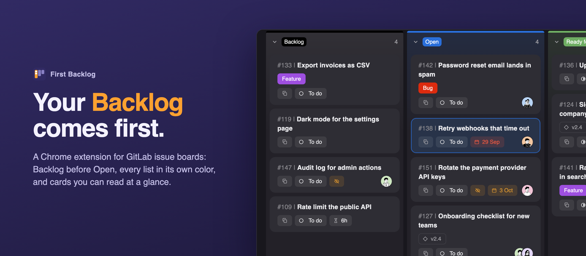

# First Backlog

A Chrome extension for GitLab issue boards.

- **Backlog first.** Your Backlog list shows before Open, which GitLab itself doesn't allow.
- **Colored lists.** Open and Closed get a colored top bar and title pill like label lists, and every list a soft glow in its color.
- **Clearer cards.** A fixed layout that keeps its size when the issue panel opens. Overdue dates turn red, dates due soon amber, and confidential issues get their own chip.
- **Open issue in view.** The card you open scrolls out from under the issue panel.
- **Copy title.** One click copies `#33 | Title`.

It only changes what you see. Nothing changes in GitLab, and it sends no requests and collects no data ([privacy policy](PRIVACY.md)).

## Install

1. Open `chrome://extensions` and turn on **Developer mode**.
2. Click **Load unpacked** and pick this folder.
3. Reload any open board.

Click the toolbar icon to switch the extension, the redesign or the copy chip on or off.

## Configure

- **Which list comes first:** `FIRST_LABELS` at the top of `content.js`.
- **Self-hosted GitLab:** add your domain next to `gitlab.com` in both `content_scripts` entries in `manifest.json`.

## Limitations

- The Backlog list always shows first, so dragging Backlog itself does nothing. Other lists and issues drag as usual.
- Epic swimlanes aren't supported.

## Development

- `scripts/package.sh` builds the store zip in `dist/`.
- `scripts/render_store_assets.sh` renders the store images and this banner from `store/src/`, using a mock board styled by the real `content.js`.
- `STORE_LISTING.md` has the Chrome Web Store texts.
